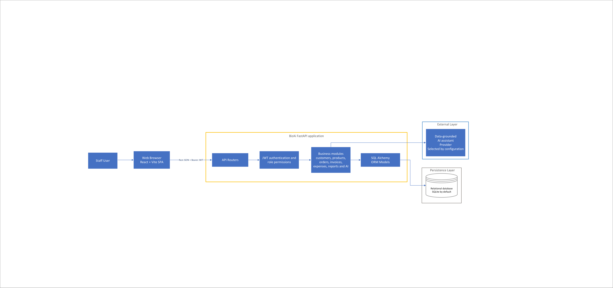
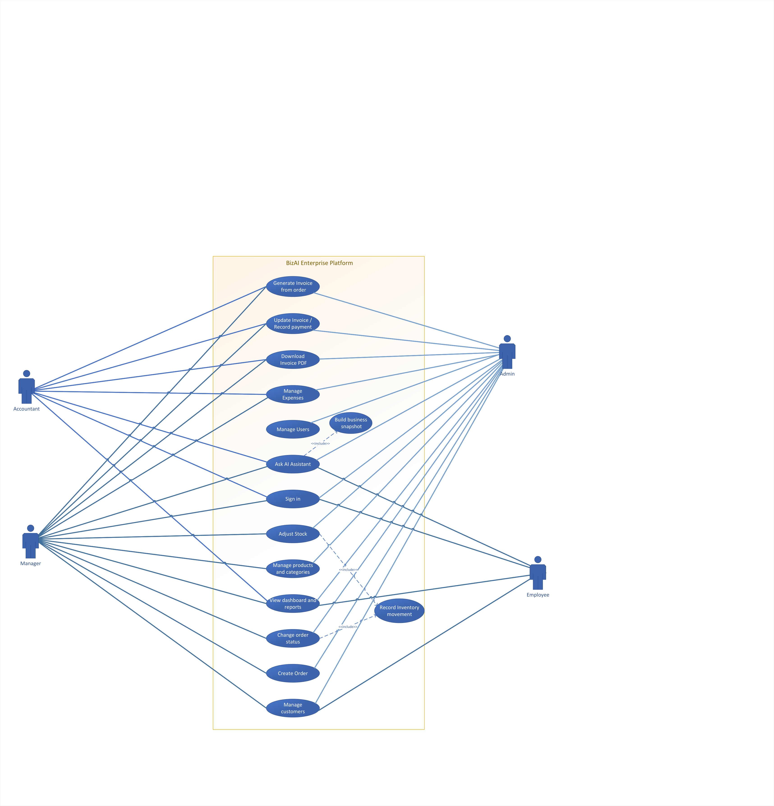
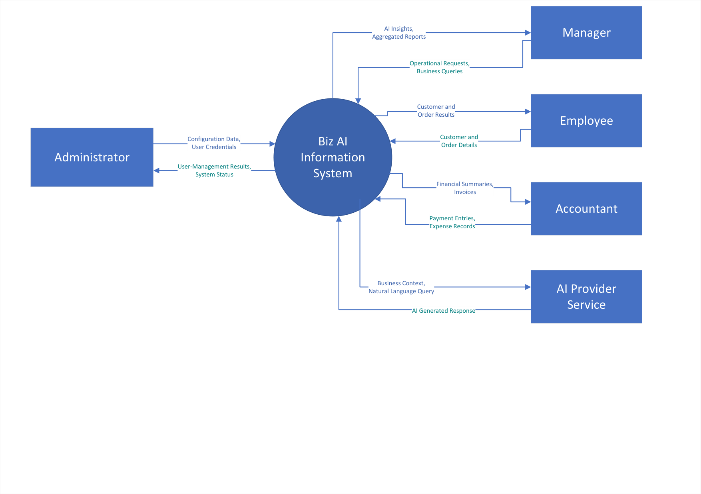
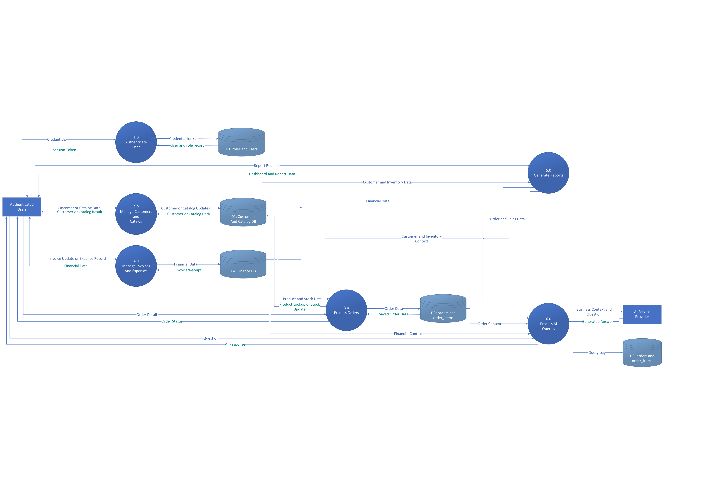
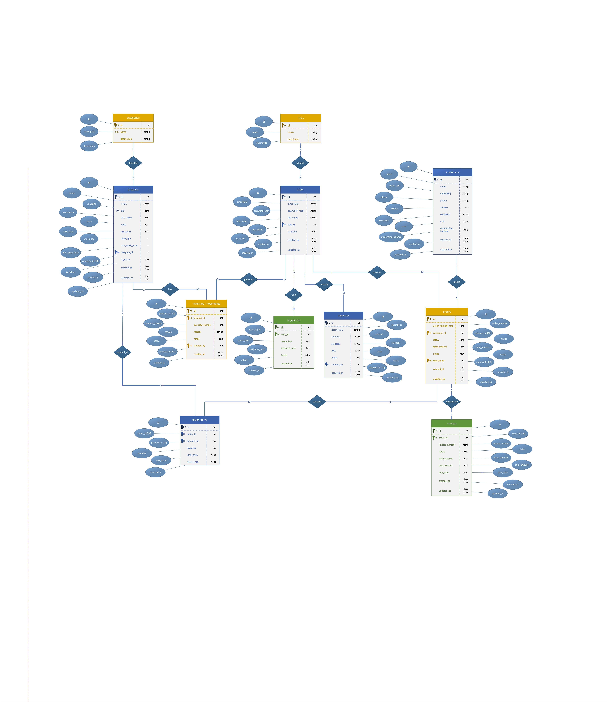
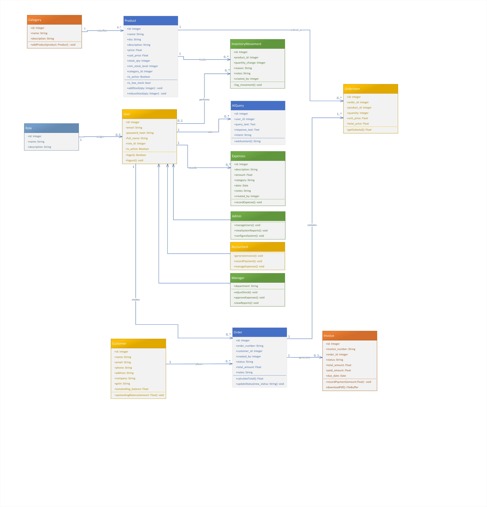

# Software Requirements Specification (SRS)
## for
# BizAI Enterprise Platform
### AI-Augmented Operations & Enterprise Resource Planning Platform
**Version 1.0 approved**  
*Standard: IEEE Std 830-1998 / ISO/IEC/IEEE 29148:2018 / Ian Sommerville SE10*

---

**Prepared for:**  
**Amber Abbas**, Business Head  
Reihh — Sector 125, Mohali, Punjab  

**Prepared by: Team YATRI**  
- **Mohammad Ibad Hussain** (24/11/EC/067) — *Team Leader & System Architect*  
- **Yash Narang** (24/11/EC/043) — *Full-Stack & Security Engineer*  
- **Ashutosh Yadav** (24/11/EC/014) — *AI & Data Pipeline Engineer*  
- **Tushar** (24/11/EC/013) — *Backend & Database Engineer*  
- **Ramji** (24/11/EC/025) — *Frontend & UI/UX Engineer*  

**Department of Computer Science & Engineering**  
**Academic Term 2026**  

*Copyright © 1999 by Karl E. Wiegers. Permission is granted to use, modify, and distribute this document.*

---

## Revision History

| Author | Date | Reason for Changes | Version |
|:---|:---|:---|:---:|
| Mohammad Ibad Hussain | Feb 10, 2026 | Initial problem definition, stakeholder identification, core scope. | 0.1 |
| Team YATRI | Feb 24, 2026 | Baselined core requirements (FR-01 to FR-06); completed DFD Level 0 and Level 1. | 0.5 |
| Ashutosh Yadav & Yash Narang | Mar 10, 2026 | Added AI Query Assistant, ReportLab PDF generation, and Sommerville NFR metrics. | 0.8 |
| Tushar & Ramji | Mar 22, 2026 | Sequence diagrams, state machines, business rules, and error code registry. | 0.9 |
| Mohammad Ibad Hussain | Apr 05, 2026 | Full IEEE 830 / ISO 29148 alignment: atomic verification, RTM, and final signoff. | 1.0 |

---

## Contents

- [1. Introduction](#1-introduction)
  - [1.1 Purpose](#11-purpose)
  - [1.2 Document Conventions](#12-document-conventions)
  - [1.3 Intended Audience and Reading Suggestions](#13-intended-audience-and-reading-suggestions)
  - [1.4 Product Scope](#14-product-scope)
  - [1.5 References](#15-references)
- [2. Overall Description](#2-overall-description)
  - [2.0 Architectural Tier / Layer Breakdown](#20-architectural-tier--layer-breakdown)
  - [2.1 Product Perspective](#21-product-perspective)
  - [2.2 Product Functions](#22-product-functions)
  - [2.3 User Classes and Characteristics](#23-user-classes-and-characteristics)
  - [2.4 Operating Environment](#24-operating-environment)
  - [2.5 Design and Implementation Constraints](#25-design-and-implementation-constraints)
  - [2.6 User Documentation](#26-user-documentation)
  - [2.7 Assumptions and Dependencies](#27-assumptions-and-dependencies)
- [3. External Interface Requirements](#3-external-interface-requirements)
  - [3.1 User Interfaces](#31-user-interfaces)
  - [3.2 Hardware Interfaces](#32-hardware-interfaces)
  - [3.3 Software Interfaces](#34-software-interfaces)
  - [3.4 Communications Interfaces](#34-communications-interfaces)
- [4. System Features](#4-system-features)
  - [4.1 User Authentication & Role-Based Access Control (RBAC)](#41-user-authentication--role-based-access-control-rbac)
  - [4.2 Customer Relationship Management (CRM) & Credit Ledger](#42-customer-relationship-management-crm--credit-ledger)
  - [4.3 Product Catalog & Dynamic Stock Tracking](#43-product-catalog--dynamic-stock-tracking)
  - [4.4 Inventory Movement & Stock Alert Subsystem](#44-inventory-movement--stock-alert-subsystem)
  - [4.5 Sales Order Processing & Transactional State Machine](#45-sales-order-processing--transactional-state-machine)
  - [4.6 Automated Invoicing & Server-Side Vector PDF Compilation](#46-automated-invoicing--server-side-vector-pdf-compilation)
  - [4.7 Operating Expense Auditing](#47-operating-expense-auditing)
  - [4.8 Executive Analytics & Profitability Engine](#48-executive-analytics--profitability-engine)
  - [4.9 Context-Grounded AI Business Query Assistant](#49-context-grounded-ai-business-query-assistant)
  - [4.10 Automated Demo Data Seeding & Sandbox Testing](#410-automated-demo-data-seeding--sandbox-testing)
- [5. Other Nonfunctional Requirements](#5-other-nonfunctional-requirements)
  - [5.1 Performance Requirements](#51-performance-requirements)
    - [5.1.1 Page Load Time](#511-page-load-time)
    - [5.1.2 Report Generation](#512-report-generation)
    - [5.1.3 Database Query Performance](#513-database-query-performance)
    - [5.1.4 Concurrent Users](#514-concurrent-users)
  - [5.2 Safety Requirements](#52-safety-requirements)
    - [5.2.1 Authentication and Credential Security](#521-authentication-and-credential-security)
    - [5.2.2 Access Control](#522-access-control)
    - [5.2.3 Application Security](#523-application-security)
    - [5.2.4 Configuration Security](#524-configuration-security)
    - [5.2.5 Session Management](#525-session-management)
  - [5.3 Security Requirements (Measurable Quality Characteristics)](#53-security-requirements-measurable-quality-characteristics)
    - [5.3.1 Availability](#531-availability)
    - [5.3.2 Reliability](#532-reliability)
    - [5.3.3 Usability](#533-usability)
    - [5.3.4 Maintainability](#534-maintainability)
    - [5.3.5 Scalability](#535-scalability)
    - [5.3.6 Security Compliance](#536-security-compliance)
    - [5.3.7 Testability](#537-testability)
  - [5.4 Software Quality Attributes](#54-software-quality-attributes)
  - [5.5 Business Rules](#55-business-rules)
- [6. Other Requirements](#6-other-requirements)
  - [6.1 Error Handling Requirements](#61-error-handling-requirements)
  - [6.2 Data Integrity Requirements](#62-data-integrity-requirements)
- [Appendix A: Glossary](#appendix-a-glossary)
- [Appendix B: Analysis Models](#appendix-b-analysis-models)
  - [10.1 Data Flow Diagrams](#101-data-flow-diagrams)
  - [10.2 Architectural & Structural Models](#102-architectural--structural-models)
  - [10.3 Behavioral Models & Sequence Diagrams](#103-behavioral-models--sequence-diagrams)
  - [10.4 Database Design Models](#104-database-design-models)
  - [10.5 Data Validation Specifications](#105-data-validation-specifications)
  - [10.6 Error Code Registry](#106-error-code-registry)
  - [10.7 Requirements Traceability Matrix (RTM)](#107-requirements-traceability-matrix-rtm)
- [Appendix C: To Be Determined List & Future Roadmap](#appendix-c-to-be-determined-list--future-roadmap)

---

## 1. Introduction

### 1.1 Purpose
This document defines the software requirements for the **BizAI Enterprise Platform** (Version 1.0 approved), an AI-augmented business operations and enterprise resource planning (ERP) system designed specifically for small-to-medium enterprises (SMEs) engaged in commercial distribution, wholesale trade, and retail operations.

**Operational Context:**
BizAI directly replaces the legacy operational workflow at Reihh (Mohali, Punjab), which previously relied upon fragmented spreadsheets, disconnected messaging channels, and physical ledgers. This legacy setup suffered from critical operational defects:
1. **Untracked Credit Balances:** Customer credit sales went unrecorded, causing liquidity bottlenecks.
2. **Stock Discrepancies & Overselling:** Inventory quantities were manually adjusted post-sale, causing negative stock anomalies.
3. **Delayed Invoicing:** Bills were compiled manually hours after fulfillment, delaying customer payment cycles.
4. **Blind Executive Decisions:** Management lacked visibility into real net margins, confusing top-line revenue with profitability.

BizAI consolidates these processes into a unified platform featuring atomic stock reservations, instant vector PDF invoices, real-time Cost of Goods Sold (COGS) analytics, and an integrated Large Language Model (LLM) assistant deterministically grounded in operational database snapshots.

### 1.2 Document Conventions
This specification conforms strictly to IEEE Std 830-1998, ISO/IEC/IEEE 29148:2018, and Ian Sommerville Software Engineering (10th Edition):
- **Normative Keywords:**
  - **'Shall'** indicates a mandatory requirement.
  - **'Should'** indicates a recommended requirement.
  - **'May'** indicates an optional requirement.
- **Requirement Identifiers:** Every requirement is uniquely identified (e.g., `REQ-ORD-1`, `REQ-AUTH-1`).
- **Atomicity & Verifiability:** All requirements are atomic, testable, and verifiable.
- **Priority & Multi-Factor Rubric:** Categorized as High, Medium, or Low, supplemented by a 1–9 rating scale: Benefit, Penalty, Cost, and Risk.
- **Hard Constraints:** Non-negotiable boundaries are marked with the `[CONSTRAINT]` tag.
- **Standardized Formats:** Currency values use Indian Rupees (INR, ₹) stored as `DECIMAL(15,2)`. Timestamps use ISO 8601 (`YYYY-MM-DDTHH:MM:SS`) stored in UTC and displayed in IST (UTC+5:30).

| Prefix | Subsystem Domain | Description | Section Reference |
|:---|:---|:---|:---|
| **AUTH** | Authentication & RBAC | User provisioning, bcrypt hashing, JWT issuance, route guards | Section 4.1 |
| **CRM** | Customer Management | Customer profiles, GSTIN validation, running credit ledger | Section 4.2 |
| **CAT** | Product Catalog | SKU management, pricing, categories, low-stock thresholds | Section 4.3 |
| **INV** | Inventory Subsystem | Manual stock adjustments, movement audit logging, alerts | Section 4.4 |
| **ORD** | Sales Order Processing | Order drafting, atomic stock deduction, lifecycle state machine | Section 4.5 |
| **INVC** | Billing & Invoicing | Idempotent billing, balance tracking, vector PDF compilation | Section 4.6 |
| **EXP** | Operating Expenses | Overhead expense logging, categorized tracking, P&L impact | Section 4.7 |
| **REP** | Analytics & Reporting | Net profit calculations, COGS engine, 30-day time-series | Section 4.8 |
| **AI** | Intelligent Assistant | JSON snapshot grounding, Groq LPU inference, local fallback | Section 4.9 |
| **DEMO** | Sandbox Simulation | One-click synthetic seeding, mock datasets, clean resets | Section 4.10 |
| **NFR** | Non-Functional Quality | Quantifiable speed, reliability, security, maintainability metrics | Section 5 |
| **BR** | Enterprise Business Rules | Operational policies, state invariants, accounting equations | Section 6 |
| **ERR** | Error Handling | Standard error response schemas, rollback guarantees, edge cases | Section 7 |
| **INT** | Data Integrity | Foreign key constraints, CHECK rules, decimal precision | Section 8 |

### 1.3 Intended Audience and Reading Suggestions

| Audience Role | Primary Objectives | Recommended Reading Sequence |
|:---|:---|:---|
| **Academic Evaluators & Examiners** | Verify system complexity, architectural rigor, UML compliance (Sommerville SE10 / UML 2.5), and requirement completeness. | §1.1 → §1.4 → §2.1 → §5.1 → Appendix B (All Figures) |
| **Software Developers** | Implement REST endpoints, business service logic, database schemas, and React components. | §2.0 → §3.3 → §4 (All features) → §7 → §8 → Appendix B |
| **QA & Test Engineers** | Extract test cases, verification conditions, validation boundaries, and stimulus/response matrices. | §1.2 → §4 (x.2 & x.3) → §5.1 → §10.6 → §10.7 (RTM) |
| **System Administrators & DevOps** | Deployment topology, environment variables, SQLite WAL / PostgreSQL configuration, and security controls. | §2.4 → §2.5 → §3.5 → §5.2 → §5.3 → §6 |
| **Business Stakeholders (Client)** | Verify business rules, operational workflows, invoicing accuracy, credit limits, and AI assistant capabilities. | §1.4 → §2.2 → §4 (x.1) → §6 (Business Rules) |

### 1.4 Product Scope
The BizAI Enterprise Platform encompasses the following functional capabilities:
- **Core Platform:** A public and authenticated corporate web platform providing dashboard monitoring, customer CRM, and inventory tracking.
- **Access Control:** A secure role-based access control (RBAC) portal for Admin, Manager, Employee, and Accountant roles.
- **Customer CRM:** Centralized customer CRM with Indian GSTIN validation, commercial coordinates, and running credit ledger balance tracking.
- **Catalog & Stock:** Dynamic product catalog with SKU uniqueness constraints, cost/retail price tracking, and real-time low-stock threshold triggers.
- **Order Processing:** Two-phase transactional order processing (draft 'pending' vs fulfilled 'confirmed') with atomic stock deductions and full rollback.
- **Automated Invoicing:** 1:1 idempotent invoice creation, payment installment tracking, and automated compilation of high-precision vector PDFs via ReportLab.
- **Expense Auditing:** Overhead expenditure logging categorized across Rent, Utilities, Salaries, Logistics, Marketing, and Miscellaneous.
- **Executive Analytics:** Automated net profitability computation: Net Profit = Revenue (non-cancelled) - COGS - Total Operating Expenses, alongside a 30-day time-series daily revenue breakdown.
- **Grounded AI Assistant:** Natural language query engine grounded in real-time JSON business snapshots, leveraging Meta LLaMA 3.1 8B via Groq Cloud LPUs with local keyword fallback.
- **Automated Demo Data:** One-click sandbox seeding generating 20 customers, 50 products, 100 orders, and 30 expenses for evaluation and testing.

**Out of Scope (Version 1.0):**
- E-commerce / online public self-checkout with payment gateway integration (Stripe, Razorpay) — planned for v2.0.
- Mobile application (Android/iOS) — responsive web layout satisfies mobile needs.
- Real-time machine or warehouse IoT sensor integration.
- Multi-warehouse distributed physical inventory tracking (`warehouse_id` FK) — planned for v2.0.
- Direct two-way accounting synchronization with external ERP systems (Tally ERP, QuickBooks) — targeted for v3.0.

### 1.5 References
1. **IEEE Std 830-1998:** IEEE Recommended Practice for Software Requirements Specifications.
2. **ISO/IEC/IEEE 29148:2018:** Systems and software engineering — Requirements engineering.
3. **Ian Sommerville:** Software Engineering, 10th Edition, Pearson Education, 2016.
4. **Booch, Rumbaugh, Jacobson:** The Unified Modeling Language User Guide, 2nd Edition.
5. **RFC 7519:** JSON Web Token (JWT) Architecture and Claims Specification.
6. **RFC 8446:** The Transport Layer Security (TLS) Protocol Version 1.3.
7. **FastAPI Documentation:** High-Performance Async REST API Architecture (`https://fastapi.tiangolo.com/`).
8. **SQLAlchemy 2.0 Docs:** Declarative Mapping and Unit of Work Architecture (`https://docs.sqlalchemy.org/`).
9. **ReportLab 4.x Manual:** Core Graphics and PDF Generation Manual (`https://reportlab.com/`).
10. **Groq Cloud API Reference:** Groq LPU Inference Engine and LLaMA 3.1 Specifications (`https://console.groq.com/docs`).

---

## 2. Overall Description

### 2.0 Architectural Tier / Layer Breakdown
BizAI is architected as a Strict Layered Modular Monolith (Sommerville SE10, §6.3.1). Every operational request flows deterministically through isolated architectural tiers:
- **2.0.1 Presentation Tier:** React 19 Single-Page Application (SPA) bundled via Vite. Implements client-side routing, optimistic UI updates, form validations, and asynchronous HTTP communication via Axios.
- **2.0.2 API Gateway & Security:** FastAPI ASGI application running on Python 3.10+ / Uvicorn. Implements OAuth2 Password Bearer authentication, PyJWT token validation, and custom RoleChecker callable dependencies for role-based authorization.
- **2.0.3 Domain Business Logic:** Pure Python service modules (`order_service.py`, `product_service.py`, `invoice_service.py`, `report_service.py`, `ai_service.py`). Enforces all business logic, financial invariants, and state machine transitions.
- **2.0.4 Persistence & ORM:** SQLAlchemy 2.0 ORM Declarative Models mapping domain entities to relational tables. Employs connection pooling and per-request scoped sessions (`get_db` dependency). Supports SQLite (WAL mode) and PostgreSQL 14+ without code alterations.
- **2.0.5 External AI Inference:** Groq Cloud Language Processing Units (LPUs) executing Meta LLaMA 3.1 8B Instant with zero parametric hallucinations via injected JSON snapshot grounding, coupled with an automatic local keyword parser fallback.

### 2.1 Product Perspective
BizAI is a self-contained, standalone web-based platform. It has no dependency on existing legacy software. The system is structured as a modular monolith – a single deployable unit with clearly bounded internal modules. A microservices approach is explicitly rejected: the system requires ACID transactions across orders, stock, and invoices, operates offline/local-first when needed, and is maintained by a small team without distributed operational overhead.

*Figure 2.2: High-Level System Architecture Diagram — 5-tier layered topology connecting React 19 SPA, FastAPI ASGI Gateway, Domain Services, SQLAlchemy ORM, and Groq LPU engine.*

| Module Name | Primary Business Responsibility | Underlying Source Code Files |
|:---|:---|:---|
| **Auth & RBAC** | User provisioning, bcrypt password hashing, JWT token generation & role checks | `routers/auth.py`, `routers/users.py`, `services/user_service.py` |
| **Customer CRM** | Customer master records, GSTIN validation, and running credit ledger | `routers/customers.py`, `services/customer_service.py`, `models/customer.py` |
| **Catalog Engine** | Product categorization, SKU constraints, cost vs retail prices, thresholds | `routers/products.py`, `services/product_service.py`, `models/product.py` |
| **Stock Subsystem** | Manual inventory adjustments, audit movement logging, low stock alerts | `routers/inventory.py`, `services/product_service.py`, `models/inventory.py` |
| **Order Orchestrator** | Order draft lifecycle, two-phase atomic stock deduction, cancel restitution | `routers/orders.py`, `services/order_service.py`, `models/order.py` |
| **Invoicing Engine** | Idempotent billing, payment recording, balance tracking, ReportLab PDF | `routers/invoices.py`, `services/invoice_service.py`, `models/invoice.py` |
| **Expense Auditor** | Overhead expense recording, categorized tracking, and P&L deduction | `routers/expenses.py`, `services/expense_service.py`, `models/expense.py` |
| **Analytics Engine** | COGS calculations, net margin computation, 30-day time-series aggregation | `routers/reports.py`, `services/report_service.py` |
| **AI Assistant** | JSON snapshot construction, Groq LPU LLaMA 3.1 dispatch, keyword fallback | `routers/ai.py`, `services/ai_service.py`, `models/ai_query.py` |
| **Demo Sandbox** | Synthetic business data generator (20 customers, 50 products, 100 orders) | `routers/demo.py`, `services/demo_service.py` |

### 2.2 Product Functions
- Secure role-based authentication and user account management (Admin, Manager, Employee, Accountant).
- Customer profile management with Indian GSTIN validation and outstanding balance ledgers.
- Product catalog categorization, pricing maintenance, and dynamic low-stock alerts.
- Inventory movement tracking with immutable audit trail and prevention of negative inventory.
- Sales order drafting, two-phase confirmation with atomic stock deduction, and status tracking.
- Idempotent invoice compilation with balance tracking and on-the-fly vector PDF downloads.
- Operating overhead expenditure logging with category aggregation.
- Executive analytics: automated COGS, Gross Margin, Net Profit, and 30-day sales time-series.
- Data-grounded AI conversational business assistant powered by Meta LLaMA 3.1 8B with offline fallback.
- Automated demo data seeding and factory reset for examiner testing and walkthroughs.

*Figure 2.3: UML System Use Case Model — 4 actors (Admin, Manager, Employee, Accountant) and 15 functional use cases with explicit «include» dependencies.*

### 2.3 User Classes and Characteristics

| User Class | Description & Operational Duties | Technical Level | Access Scope |
|:---|:---|:---|:---|
| **Admin (Owner)** | Full system access: user management, demo data seeding/purging, configuration, void operations, and all modules. | Medium-to-high | Full unrestricted access across all endpoints. |
| **Manager** | Operational supervisor: approves stock adjustments, confirms draft orders, manages price lists, and reviews profitability. | Medium | Operational + Financial (no user provisioning). |
| **Employee / Clerk** | Front-counter staff: registers customer inquiries, views catalog, and enters draft sales orders. | Low | Operational (catalog, customer entry, order drafts). |
| **Accountant** | Financial auditor: generates invoices, records payment installments, downloads PDF invoices, and logs expenses. | Medium | Financial (invoices, payments, expenses, reports). |

### 2.4 Operating Environment
- **Server OS:** Windows 10/11, Windows Server 2019/2022, or Ubuntu 22.04 LTS.
- **Backend Runtime:** Python 3.10+ (tested on Python 3.11/3.14) with FastAPI framework and Uvicorn ASGI.
- **Frontend:** React 19 (bundled with Vite) and Tailwind CSS / Vanilla CSS.
- **Database:** SQLite 3.35+ with Write-Ahead Logging (WAL) or PostgreSQL 15+ with SQLAlchemy 2.0 ORM.
- **Client:** Any modern web browser (Google Chrome 110+, Mozilla Firefox 110+, Microsoft Edge 110+, Safari 16+).
- **Display:** Minimum 1280×720 resolution for management dashboard; fully responsive for mobile/tablet.
- **Network:** Standard broadband connection for Groq Cloud AI API; offline-capable for all core ERP functions.

### 2.5 Design and Implementation Constraints
- The web interface should be fully responsive and accessible across desktop and mobile devices.
- All portal routes must be protected with authentication middleware; unauthorized requests must redirect to `/login`.
- Internal portal page load time should not exceed 2 seconds; API CRUD responses must complete within 100ms.
- All operational data belongs strictly to Reihh. The development team shall not store or leak commercial data.
- **[CONSTRAINT-01] Stateless API:** The REST API shall remain entirely stateless. Authentication credentials shall be validated via Bearer JWTs.
- **[CONSTRAINT-02] Transactional Atomicity:** Stock deductions and order confirmations must execute within atomic transactions with immediate rollback on error.
- **[CONSTRAINT-03] Zero-Hallucination AI:** The AI assistant must not fabricate business numbers; it must evaluate a fresh JSON snapshot before every response.
- **[CONSTRAINT-04] Decimal Precision:** All financial values must be stored and computed as `DECIMAL(15,2)`. Floating-point types are prohibited.
- **[CONSTRAINT-05] Password Hashing:** User passwords must be hashed using bcrypt with a minimum work factor of 12.

### 2.6 User Documentation
The system shall be delivered with the following user documentation components to assist end users and administrators:
- **User Manual:** Describing system features, navigation, and step-by-step instructions for performing key tasks such as customer creation, order confirmation, invoice generation, and expense tracking.
- **Online Guidance:** Integrated within the application with contextual tooltips, error explanations, and status badge legends.
- **Quick Start Guide:** For initial system setup, environment configuration (`.env`), and basic usage for Admin and staff roles.
- **Technical Documentation:** For developers, including system architecture, interactive Swagger UI at `/docs`, ReDoc at `/redoc`, and database schema diagrams.

### 2.7 Assumptions and Dependencies
- Client Reihh will offer hosting infrastructure prior to the final deployment phase.
- All product details, categories, and initial pricing lists will be provided by the client during setup.
- The client operates under Indian commercial accounting regulations and GST taxation frameworks.
- At least one default Admin account is provisioned during initial system bootstrapping.
- Outbound internet access is available for Groq Cloud API; if disconnected, local fallback handles all queries.

---

## 3. External Interface Requirements

### 3.1 User Interfaces

| Screen Name | Route | Functional Interface Description |
|:---|:---|:---|
| **Login Screen** | `/login` | Centered card interface featuring email and password inputs, show/hide password toggle, validation messages, and immediate JWT credential capture into browser localStorage. |
| **Executive Dashboard** | `/` | Real-time command center displaying 4 KPI summary cards (Total Revenue, Net Profit, Active Orders, Low Stock Alerts), a 30-day daily sales revenue line chart (Chart.js 4), and quick-action buttons. |
| **Customer CRM View** | `/customers` | Filterable, searchable data table listing customer accounts, outstanding balances, and GSTIN numbers. Includes a slide-out modal for registering or editing customer profiles. |
| **Product Catalog** | `/products` | Comprehensive catalog grid showing product SKU, name, category, cost price, retail price, stock level, and an amber 'Low Stock' badge when quantity falls below min_stock_level. |
| **Inventory Adjustment** | `/inventory` | Warehouse management interface featuring an audit history table of stock movements and a quick-adjustment modal with inputs for delta quantity (+/-) and mandatory business reason. |
| **Order Processing** | `/orders` | Sales order workspace supporting multi-item order drafting, dynamic subtotal calculation, and order lifecycle management via an interactive status stepper (pending → confirmed → shipped → delivered). |
| **Invoice Center** | `/invoices` | Billing ledger displaying generated invoices, payment status badges (Paid, Partially Paid, Sent), installment payment recording modal, and a one-click 'Download PDF' trigger. |
| **Expense Ledger** | `/expenses` | Operating overhead management screen showing categorized expenditures (Rent, Utilities, Salaries, Logistics, Marketing, Misc) with date filters and a monthly aggregate summary card. |
| **Analytics & Reports** | `/reports` | Deep-dive business intelligence interface detailing COGS breakdowns, gross margins, top-5 revenue generating products, and printable P&L financial summaries. |
| **AI Business Assistant** | `/ai` | Interactive natural language chat drawer allowing staff to submit operational queries. Displays formatted Markdown answers with live numbers, grounded in real-time JSON snapshots. |

- **Confirmation Dialogs:** All destructive or irreversible actions (deleting records, cancelling confirmed orders, purging demo data) SHALL be confirmed with a modal confirmation dialog before execution.
- **Inline Validation:** Validation errors SHALL be displayed inline adjacent to the offending input fields with specific corrective instructions.

### 3.2 Hardware Interfaces
The system is a web-based application and does not require direct interaction with specialized hardware components. However, it interfaces with standard computing devices as follows:
- **User Workstations:** The system shall function on user workstations, including desktop computers and laptops running Windows, macOS, or Linux.
- **Input Devices:** The system shall allow interaction through standard input devices (keyboard, mouse, trackpad, touchscreen).
- **Display Devices:** The system shall display output through standard displays with a resolution of at least 1280×720 pixels.
- **Network Devices:** The system shall communicate over standard networking devices using TCP/IP protocols for local and internet access.
- **Server Hardware:** The server shall function on standard compute instances capable of running Python 3.10+ and SQLite/PostgreSQL database operations.
- **Printer Interface:** Physical or virtual printing is handled via standard browser-native PDF print dialogs without external drivers.

### 3.3 Software Interfaces
- **FastAPI & Pydantic v2:** Powers REST controllers, enforces request/response schemas, serializes JSON, and auto-generates OpenAPI 3.0 specs at `/docs`.
- **SQLAlchemy 2.0 ORM:** Maps object models to relational tables using DeclarativeBase; manages connection pooling and database transactions across SQLite and PostgreSQL.
- **ReportLab 4.x:** Server-side high-precision vector PDF generation engine that dynamically compiles invoice documents with corporate letterheads, line-item tables, and payment statuses.
- **Groq Python SDK:** Asynchronous HTTPS client communicating with Groq Cloud LPU clusters for low-latency Meta LLaMA 3.1 8B inference.
- **Axios REST Client:** Browser HTTP client configured with request interceptors to automatically attach the `Authorization: Bearer <JWT>` header from browser localStorage.

### 3.4 Communications Interfaces
- **Protocol:** The system shall operate on HTTP/HTTPS protocols. HTTPS over TLS 1.3 (RFC 8446) shall be used for secure production communication.
- **Payloads:** The client application (React frontend) communicates with the backend (FastAPI) via RESTful APIs with JSON payloads.
- **Browsers:** The system operates through standard web browsers (Chrome, Firefox, Edge, Safari) over local network or internet.
- **Authorization:** Token-based authentication (HMAC-SHA256 JWT) is used for secure API authorization on every protected request.
- **CORS:** FastAPI CORSMiddleware restricts allowed origins, HTTP methods, and headers to authorized frontend origins.
- **Data Rates:** The system operates efficiently over standard broadband connections with minimal latency (< 100ms CRUD).

---

## 4. System Features

### 4.1 User Authentication & Role-Based Access Control (RBAC)

#### 4.1.1 Description and Priority
**Priority: [High] | Ratings: Benefit: 9/9, Penalty: 9/9, Cost: 4/9, Risk: 4/9**  
Provides cryptographic user authentication and strict role-based access control. Staff members authenticate using email and password to receive a cryptographically signed HMAC-SHA256 JWT containing their `user_id`, `email`, and `role` claim. Every protected API endpoint enforces role authorization via FastAPI RoleChecker dependencies. Four roles are supported: Admin, Manager, Employee, and Accountant.

#### 4.1.2 Stimulus/Response Sequences

| Stimulus (User / System Action) | System Response |
|:---|:---|
| Staff enters valid email and correct password on `/login` | HTTP 200 OK; issues signed JWT (exp=30 min); client stores token in localStorage and redirects to Dashboard. |
| Staff enters nonexistent email or incorrect password | HTTP 401 Unauthorized; returns ERR-AUTH-001 ('Invalid email or password'); login denied. |
| Inactive user account attempts authentication | HTTP 403 Forbidden; returns ERR-AUTH-002 ('User account is deactivated. Contact administrator.'). |
| Employee attempts to invoke `/api/users` or `/api/demo/generate` | HTTP 403 Forbidden; RoleChecker blocks request with ERR-AUTH-004; logs security violation. |
| Expired or tampered JWT passed in Authorization header | HTTP 401 Unauthorized; returns ERR-AUTH-003 ('Could not validate credentials'); redirects to login. |
| Admin creates new staff account via POST `/api/users` | HTTP 201 Created; hashes password with bcrypt (cost 12); persists user in users table. |

#### 4.1.3 Functional Requirements

| Requirement ID | Requirement Statement & Validation Rules |
|:---|:---|
| **REQ-AUTH-1** | The system SHALL hash all user passwords using the bcrypt algorithm with a minimum work factor (cost) of 12 prior to database insertion. Plaintext passwords SHALL NOT be logged or persisted. |
| **REQ-AUTH-2** | The system SHALL issue an HMAC-SHA256 signed JSON Web Token (JWT) upon successful authentication containing claims: sub (email), user_id, role, and exp (30 minutes from issue). |
| **REQ-AUTH-3** | The system SHALL enforce endpoint-level authorization via RoleChecker callable dependencies on all protected routes, rejecting unauthorized roles with HTTP 403 Forbidden. |
| **REQ-AUTH-4** | The system SHALL provide administrative user provisioning endpoints (GET/POST `/api/users`) restricted exclusively to the Admin role, enabling staff creation, role assignment, and account deactivation. |

---

### 4.2 Customer Relationship Management (CRM) & Credit Ledger

#### 4.2.1 Description and Priority
**Priority: [High] | Ratings: Benefit: 8/9, Penalty: 8/9, Cost: 4/9, Risk: 3/9**  
Maintains master records of commercial customers, contact coordinates, commercial tax identifiers (GSTIN), and running credit ledgers. Accurately tracks outstanding balances, automatically updating when invoices are issued and payments are credited.

#### 4.2.2 Stimulus/Response Sequences

| Stimulus (User / System Action) | System Response |
|:---|:---|
| Staff submits new customer form with valid details | HTTP 201 Created; validates GSTIN format; inserts record in customers table with outstanding_balance = 0.00. |
| Staff submits customer with invalid phone or duplicate email | HTTP 422 Unprocessable Entity; displays specific field validation error. |
| Staff enters search keyword in customer directory | HTTP 200 OK; performs case-insensitive substring search across name, company, and phone; returns matches within 100ms. |
| Invoice is generated for customer order | System automatically increments customer outstanding_balance by invoice total_amount inside database transaction. |
| Payment installment is recorded against an invoice | System automatically decrements customer outstanding_balance by paid_amount inside database transaction. |

#### 4.2.3 Functional Requirements

| Requirement ID | Requirement Statement & Validation Rules |
|:---|:---|
| **REQ-CRM-1** | The system SHALL store customer name, email (unique, nullable), phone, address, company name, GSTIN, and outstanding_balance in the customers table. |
| **REQ-CRM-2** | The system SHALL automatically increment customer outstanding_balance upon invoice generation and decrement it upon payment settlement within atomic database transactions. |
| **REQ-CRM-3** | The system SHALL provide case-insensitive substring search capabilities across customer name, company name, and phone number via GET `/api/customers?search=<query>`. |
| **REQ-CRM-4** | The system SHALL prevent hard deletion of any customer entity associated with existing sales orders or invoices, enforcing referential integrity (soft delete via status flag). |

---

### 4.3 Product Catalog & Dynamic Stock Tracking

#### 4.3.1 Description and Priority
**Priority: [High] | Ratings: Benefit: 9/9, Penalty: 9/9, Cost: 5/9, Risk: 4/9**  
Manages the enterprise product catalog across multiple categories, tracking inventory stock levels, purchase cost prices, and selling prices. Automatically triggers low-stock alerts when inventory drops to or below the defined minimum threshold.

#### 4.3.2 Stimulus/Response Sequences

| Stimulus (User / System Action) | System Response |
|:---|:---|
| Manager creates new product with unique SKU and prices | HTTP 201 Created; validates price >= cost_price >= 0; persists record in products table. |
| Staff attempts to create product with existing SKU | HTTP 400 Bad Request; returns ERR-CAT-001 ('Product with SKU already exists') due to UNIQUE constraint. |
| Product stock quantity falls to or below min_stock_level | System automatically flags product as Low Stock; displays amber warning badge; lists SKU in `/api/products/low-stock`. |
| Manager updates selling price or cost price of product | HTTP 200 OK; updates product record; future orders adopt new pricing while existing orders preserve historical price. |

#### 4.3.3 Functional Requirements

| Requirement ID | Requirement Statement & Validation Rules |
|:---|:---|
| **REQ-CAT-1** | The system SHALL enforce global uniqueness on product SKU codes via a database UNIQUE constraint on `products.sku`. |
| **REQ-CAT-2** | The system SHALL store both price (retail selling price) and cost_price (wholesale acquisition cost) for every product to enable COGS and gross margin computations. |
| **REQ-CAT-3** | The system SHALL flag any product where `stock_qty <= min_stock_level` as Low Stock and expose these items via GET `/api/products/low-stock` for dashboard alerts. |
| **REQ-CAT-4** | The system SHALL categorize products via a foreign key relationship to the categories table, supporting category-based filtering and analytics. |

---

### 4.4 Inventory Movement & Stock Alert Subsystem

#### 4.4.1 Description and Priority
**Priority: [High] | Ratings: Benefit: 8/9, Penalty: 8/9, Cost: 4/9, Risk: 4/9**  
Executes manual stock adjustments (replenishments, write-offs, damage adjustments) while creating an immutable audit trail in the `inventory_movements` table. Guarantees that stock levels can never become negative.

#### 4.4.2 Stimulus/Response Sequences

| Stimulus (User / System Action) | System Response |
|:---|:---|
| Manager submits positive adjustment (+50 replenishment) | HTTP 200 OK; increments stock_qty by 50; inserts row in inventory_movements with user_id, reason, and timestamp. |
| Manager submits negative adjustment exceeding stock_qty | HTTP 400 Bad Request; rejects transaction; returns ERR-INV-002 ('Insufficient stock. Result cannot be negative.'). |
| Non-manager staff attempts manual stock adjustment | HTTP 403 Forbidden; RoleChecker blocks adjustment; requires Manager or Admin privilege. |
| Warehouse staff views inventory audit ledger | HTTP 200 OK; returns paginated movement log with product SKU, delta, reason, author, and timestamp. |

#### 4.4.3 Functional Requirements

| Requirement ID | Requirement Statement & Validation Rules |
|:---|:---|
| **REQ-INV-1** | The system SHALL reject any inventory adjustment that would result in `stock_qty < 0`, raising HTTP 400 Bad Request before any database write. |
| **REQ-INV-2** | The system SHALL log every stock quantity alteration in the immutable `inventory_movements` table, recording `product_id`, `change_qty`, `reason`, `user_id`, and `created_at`. |
| **REQ-INV-3** | The system SHALL restrict manual inventory adjustment operations (POST `/api/products/{id}/stock`) to users holding the Manager or Admin role. |
| **REQ-INV-4** | The system SHALL provide an audit endpoint (GET `/api/inventory/movements`) returning historical stock adjustments with filtering by product and date range. |

---

### 4.5 Sales Order Processing & Transactional State Machine

#### 4.5.1 Description and Priority
**Priority: [High] | Ratings: Benefit: 9/9, Penalty: 9/9, Cost: 6/9, Risk: 5/9**  
Orchestrates the entire sales order lifecycle from initial drafting to final fulfillment. Enforces a strict Finite State Machine (FSM): `pending` → `confirmed` → `shipped` → `delivered` (or → `cancelled`). Stock quantities remain unreserved during 'pending' draft status and are atomically deducted only upon transition to 'confirmed'. Order cancellations automatically restore deducted stock quantities.

#### 4.5.2 Stimulus/Response Sequences

| Stimulus (User / System Action) | System Response |
|:---|:---|
| Employee drafts new order with line items | HTTP 201 Created; generates unique ORD-YYYY-XXXX number; sets status='pending'; stock_qty is NOT deducted. |
| Manager updates order status from pending to confirmed | System verifies stock for all items; atomically deducts stock_qty; logs inventory movements; updates status to 'confirmed'. |
| Manager attempts confirmation when an item has insufficient stock | System halts; raises ValueError; executes full db.rollback(); returns HTTP 400 with ERR-ORD-002 detailing the shortfall; status remains 'pending'. |
| Order status updated from confirmed/shipped to cancelled | System atomically restores stock_qty (+quantity) for all order items; logs restitution inventory movements; sets status='cancelled'. |
| Staff attempts invalid transition (e.g., delivered to pending) | HTTP 400 Bad Request; returns ERR-ORD-003 ('Invalid status transition from delivered to pending'). |

#### 4.5.3 Functional Requirements

| Requirement ID | Requirement Statement & Validation Rules |
|:---|:---|
| **REQ-ORD-1** | The system SHALL create initial sales orders in 'pending' status without altering product `stock_qty`, assigning a unique sequential order_number (ORD-YYYY-XXXX). |
| **REQ-ORD-2** | Upon transition from 'pending' to 'confirmed', the system SHALL verify available stock for all line items and atomically deduct quantities within a single database transaction. |
| **REQ-ORD-3** | If any line item has insufficient stock during confirmation, the system SHALL execute a full database ROLLBACK, preserve order status as 'pending', and return HTTP 400 detailing the shortfall. |
| **REQ-ORD-4** | Upon transition to 'cancelled' from 'confirmed' or 'shipped', the system SHALL automatically restore stock quantities for all constituent items and record restitution movements. |
| **REQ-ORD-5** | The system SHALL enforce strict state machine transitions: pending → [confirmed, cancelled]; confirmed → [shipped, cancelled]; shipped → [delivered, cancelled]; delivered → [none]. |

---

### 4.6 Automated Invoicing & Server-Side Vector PDF Compilation

#### 4.6.1 Description and Priority
**Priority: [High] | Ratings: Benefit: 9/9, Penalty: 8/9, Cost: 5/9, Risk: 4/9**  
Generates idempotent billing invoices from sales orders, records payment installments, maintains balance due ledgers, and compiles high-precision vector PDF invoices on the fly using ReportLab 4.x. Exactly one invoice is permitted per sales order.

#### 4.6.2 Stimulus/Response Sequences

| Stimulus (User / System Action) | System Response |
|:---|:---|
| Staff clicks 'Generate Invoice' on a sales order | HTTP 200 OK; checks if invoice exists; if not, creates INV-YYYY-XXXX with due_date = created_at + 15 days; returns invoice details. |
| Staff clicks 'Generate Invoice' on an order that already has an invoice | HTTP 200 OK; returns existing invoice idempotently without creating duplicate records. |
| Accountant records partial payment installment of ₹5,000 | HTTP 200 OK; increments paid_amount; updates balance_due = total - paid; updates status to 'partially_paid'. |
| Accountant records final payment settling balance_due to 0 | HTTP 200 OK; updates paid_amount; sets balance_due = 0.00; transitions invoice status to 'paid'. |
| Staff clicks 'Download PDF' for an invoice | HTTP 200 OK; ReportLab compiles vector PDF in memory; streams file as application/pdf with Content-Disposition attachment. |

#### 4.6.3 Functional Requirements

| Requirement ID | Requirement Statement & Validation Rules |
|:---|:---|
| **REQ-INVC-1** | The system SHALL enforce a 1:1 unique relationship between orders and invoices (`invoices.order_id` UNIQUE), ensuring idempotent invoice generation. |
| **REQ-INVC-2** | The system SHALL automatically calculate invoice `due_date` as `issue_date + 15 calendar days` and initialize `balance_due` equal to `total_amount`. |
| **REQ-INVC-3** | The system SHALL record payment installments, recalculate `balance_due`, and automatically transition status: sent → partially_paid (when paid > 0) → paid (when balance_due == 0). |
| **REQ-INVC-4** | The system SHALL compile vector PDF invoices using ReportLab 4.x featuring company branding, customer details, line-item table, tax summary, and payment status stamp. |

---

### 4.7 Operating Expense Auditing

#### 4.7.1 Description and Priority
**Priority: [Medium] | Ratings: Benefit: 7/9, Penalty: 7/9, Cost: 3/9, Risk: 2/9**  
Tracks operational overhead expenditures (rent, utilities, salaries, logistics, marketing, miscellaneous) to ensure that executive profitability reports reflect true net earnings rather than gross margins.

#### 4.7.2 Stimulus/Response Sequences

| Stimulus (User / System Action) | System Response |
|:---|:---|
| Accountant logs monthly facility rent of ₹45,000 | HTTP 201 Created; validates category in permitted enum; persists in expenses table; net profit recalculates immediately. |
| User submits expense with negative amount or missing category | HTTP 422 Unprocessable Entity; rejects transaction with validation message. |
| Staff views expense breakdown on Reports view | HTTP 200 OK; aggregates total overhead by category and date range; displays interactive pie/bar breakdown. |

#### 4.7.3 Functional Requirements

| Requirement ID | Requirement Statement & Validation Rules |
|:---|:---|
| **REQ-EXP-1** | The system SHALL record operating expenses with category (Rent, Utilities, Salaries, Logistics, Marketing, Miscellaneous), amount (positive decimal), description, and expense_date. |
| **REQ-EXP-2** | The system SHALL restrict expense creation and modification to users holding Accountant, Manager, or Admin roles. |
| **REQ-EXP-3** | The system SHALL incorporate the aggregate sum of all operating expenses (`SUM(expenses.amount)`) into executive net profit computations. |

---

### 4.8 Executive Analytics & Profitability Engine

#### 4.8.1 Description and Priority
**Priority: [High] | Ratings: Benefit: 9/9, Penalty: 8/9, Cost: 6/9, Risk: 4/9**  
Aggregates real-time business health metrics across orders, cost of goods sold (COGS), inventory valuations, and operating expenses. Computes true enterprise Net Profit and delivers 30-day time-series daily revenue data.

#### 4.8.2 Stimulus/Response Sequences

| Stimulus (User / System Action) | System Response |
|:---|:---|
| Executive opens Dashboard or Reports page | HTTP 200 OK; calculates Total Revenue, COGS, Operating Expenses, Net Profit, and 30-day revenue trend in < 100ms. |
| Order is cancelled or payment recorded | Dashboard metrics immediately reflect updated revenue and net profit figures upon subsequent API poll or refresh. |
| Staff queries top revenue-generating products | HTTP 200 OK; returns top-5 ranked products by gross sales volume alongside inventory status. |

#### 4.8.3 Functional Requirements

| Requirement ID | Requirement Statement & Validation Rules |
|:---|:---|
| **REQ-REP-1** | The system SHALL compute Net Profit using the exact formula: `Net Profit = Total Sales Revenue (non-cancelled orders) - COGS - Total Operating Expenses`. |
| **REQ-REP-2** | The system SHALL calculate Cost of Goods Sold (COGS) as `SUM(order_item.quantity * product.cost_price)` exclusively for orders with `status != 'cancelled'`. |
| **REQ-REP-3** | The system SHALL aggregate a 30-day daily sales revenue time-series formatted for direct rendering by Chart.js 4 canvas elements. |
| **REQ-REP-4** | The system SHALL deliver executive summary metrics via GET `/api/reports/dashboard` with 95th percentile response latency under 100 milliseconds. |

---

### 4.9 Context-Grounded AI Business Query Assistant

#### 4.9.1 Description and Priority
**Priority: [High] | Ratings: Benefit: 9/9, Penalty: 7/9, Cost: 6/9, Risk: 5/9**  
Provides an intelligent natural language conversational interface grounded deterministically in real-time database snapshots. Eliminates Large Language Model hallucinations by injecting live operational numbers into the prompt context, leveraging Meta LLaMA 3.1 8B on Groq Cloud LPUs with automatic local keyword fallback.

#### 4.9.2 Stimulus/Response Sequences

| Stimulus (User / System Action) | System Response |
|:---|:---|
| Staff submits query: 'What is our net margin this month and which items need reordering?' | System builds JSON snapshot; dispatches to Groq LLaMA 3.1 8B; returns grounded markdown response in < 1.5s with exact figures. |
| Outbound internet connection severed or Groq API unavailable | System catches connection exception; logs warning; automatically routes query to local `_fallback_answer()` keyword engine; returns accurate database metrics. |
| Staff asks query unrelated to business operations (e.g. poetry) | AI system responds concisely stating its scope is strictly restricted to BizAI business analytics and operations. |
| Staff submits query without Bearer token | HTTP 401 Unauthorized; prompt rejected; security log recorded. |

#### 4.9.3 Functional Requirements

| Requirement ID | Requirement Statement & Validation Rules |
|:---|:---|
| **REQ-AI-1** | The system SHALL construct a deterministic JSON business snapshot via `report_service.build_business_snapshot()` before every AI assistant invocation. |
| **REQ-AI-2** | The system SHALL inject the JSON snapshot into the system prompt of Meta LLaMA 3.1 8B Instant via Groq Cloud LPUs, prohibiting parametric hallucinations. |
| **REQ-AI-3** | The system SHALL provide an automated local fallback engine (`_fallback_answer()`) that parses intent keywords and computes exact database metrics when Groq Cloud is unreachable. |
| **REQ-AI-4** | The system SHALL record every AI interaction in the `ai_queries` table, storing `user_id`, `prompt`, `response`, `model_used`, and `timestamp`. |

---

### 4.10 Automated Demo Data Seeding & Sandbox Testing

#### 4.10.1 Description and Priority
**Priority: [Medium] | Ratings: Benefit: 8/9, Penalty: 6/9, Cost: 3/9, Risk: 2/9**  
Enables evaluators, academic examiners, and test engineers to populate the system with a complete, statistically realistic commercial dataset with a single click, or reset the sandbox to a clean baseline state.

#### 4.10.2 Stimulus/Response Sequences

| Stimulus (User / System Action) | System Response |
|:---|:---|
| Admin clicks 'Generate Demo Data' or calls POST `/api/demo/generate` | HTTP 200 OK; populates 20 customers, 50 products across 5 categories, 100 historical orders, and 30 expenses in < 3 seconds. |
| Admin clicks 'Clear Database' or calls POST `/api/demo/clear` | HTTP 200 OK; safely purges all transactional records while preserving core admin user accounts and roles. |
| Non-admin user attempts to call demo endpoints | HTTP 403 Forbidden; RoleChecker blocks operation. |

#### 4.10.3 Functional Requirements

| Requirement ID | Requirement Statement & Validation Rules |
|:---|:---|
| **REQ-DEMO-1** | The system SHALL provide POST `/api/demo/generate` (Admin only) to seed 20 realistic customers, 50 products, 100 sales orders with items, and 30 expenses within 3 seconds. |
| **REQ-DEMO-2** | The system SHALL provide POST `/api/demo/clear` (Admin only) to purge all transactional records while strictly preserving default user accounts and role definitions. |
| **REQ-DEMO-3** | The system SHALL seed realistic temporal distributions across order dates (past 60 days) to populate authentic time-series charts on the dashboard. |

---

## 5. Other Nonfunctional Requirements

### 5.1 Performance Requirements

#### 5.1.1 Page Load Time
- Public and static pages shall load within 2 seconds under normal broadband conditions (>= 10 Mbps).
- Internal portal pages (dashboard, customer CRM, catalog, orders) shall load within 1.5 seconds after successful authentication.
- *Rationale:* Ensures high worker productivity and minimizes front-counter transactional latency.

#### 5.1.2 Report Generation
- PDF invoice compilation and streaming via ReportLab shall complete within 300 milliseconds.
- Executive dashboard financial aggregations (revenue, COGS, net profit) shall compute within 100 milliseconds for datasets up to 100,000 orders.
- *Rationale:* Supports real-time operational efficiency during customer checkout and executive decision-making.

#### 5.1.3 Database Query Performance
- Queries for orders, customers, and product inventory shall return results within 50 milliseconds.
- Full text substring search across customer directory shall complete in under 100 milliseconds for up to 50,000 records.
- *Rationale:* Eliminates UI stutter during real-time customer search and order entry.

#### 5.1.4 Concurrent Users
- The system shall support at least 50 concurrent authenticated staff users without response time degradation beyond defined thresholds.
- *Rationale:* Accommodates multi-counter retail and wholesale operations during peak business hours.

#### Quantitative Metric Matrix (Sommerville SE10 Table 4.5)

| Quality Property | Quantitative Metric & Measurement Method | Target Threshold | Architectural Realization |
|:---|:---|:---:|:---|
| **Response Speed (CRUD)** | 95th percentile latency for REST API CRUD transactions | < 100 ms | FastAPI async ASGI architecture, SQLAlchemy connection pooling, SQLite WAL mode indexing. |
| **Response Speed (AI)** | Total latency for grounded AI assistant query generation | < 1,500 ms | Groq Cloud ultra-fast LPU inference clusters; pre-aggregated JSON snapshots. |
| **Client Interactivity** | Client-side view transition and route navigation latency | < 50 ms | React 19 SPA architecture with React Router 7; zero full-page document reloads. |
| **Memory Footprint** | Server process resident RAM consumption at idle / under load | < 120 MB idle < 250 MB at 50 req/s | Lightweight Python ASGI process; scoped database sessions released immediately. |
| **Database Throughput** | Batch insertion rate for synthetic demo records | > 200 records/sec | SQLAlchemy bulk_insert_mappings with batched transaction commits. |
| **Report Generation** | Time required to compile and stream full ReportLab PDF invoice | < 300 ms | Pure in-memory BytesIO vector canvas rendering without intermediate disk I/O. |
| **Concurrency Support** | Simultaneous active HTTP client requests without degradation | Min 50 concurrent users | Uvicorn asynchronous event loop with non-blocking threadpool workers. |
| **Recovery Time (MTTR)** | Time to recover operational capability following crash restart | < 5 seconds | SQLite WAL automatic journal recovery; stateless REST server initialization. |

### 5.2 Safety Requirements

#### 5.2.1 Authentication and Credential Security
- All user passwords shall be hashed using bcrypt with a minimum work factor (cost) of 12.
- Plaintext passwords shall never be stored in the database or written to application logs.
- Password complexity rules shall require a minimum of 8 characters including letters and digits.

#### 5.2.2 Access Control
- All internal management routes shall require authentication via FastAPI Bearer token dependencies.
- Unauthenticated requests shall be rejected with HTTP 401 Unauthorized.
- Role-Based Access Control (RBAC) shall be strictly enforced on the server. Clerks cannot confirm orders, adjust stock, or view executive net margins.

#### 5.2.3 Application Security
- SQL Injection is prevented by executing all database queries through SQLAlchemy 2.0 ORM parameterized query builders. Raw string concatenation is prohibited.
- Cross-Site Scripting (XSS) is prevented by automatic context-aware HTML escaping in React 19 JSX.
- Cross-Site Request Forgery (CSRF) is prevented by employing stateless Bearer token authorization stored in JavaScript memory/localStorage rather than ambient cookies.

#### 5.2.4 Configuration Security
- Sensitive credentials (database URL, JWT secret key, Groq API key) shall be stored exclusively in an environment configuration file (`.env`) and never hardcoded in source repositories.

#### 5.2.5 Session Management
- User JWT tokens shall expire after 30 minutes of inactivity. The client must prompt re-authentication upon token expiration.

### 5.3 Security Requirements (Measurable Quality Characteristics)
- **5.3.1 Availability:** The system shall achieve >= 99.5% uptime during standard business hours (08:00–20:00 IST), excluding scheduled maintenance. Priority: High.
- **5.3.2 Reliability:** Critical transactional operations (order confirmation, stock deduction, invoice payment) shall have a failure rate of < 0.1%. Priority: Critical.
- **5.3.3 Usability:** Users shall be capable of creating customer records and drafting sales orders within 3–4 clicks after login. Priority: High.
- **5.3.4 Maintainability:** The codebase shall follow a modular layered architecture allowing feature enhancements without impacting unrelated modules (< 15% code impact). Priority: High.
- **5.3.5 Scalability:** The system backend shall be stateless, supporting horizontal scaling behind load balancers with database migration path to PostgreSQL. Priority: High.
- **5.3.6 Security Compliance:** The system shall comply with OWASP Top 10 web application security guidelines. Priority: Critical.
- **5.3.7 Testability:** The service layer business logic shall maintain at least 80% automated unit and integration test coverage. Priority: Medium.

### 5.4 Software Quality Attributes
- **5.4.1 Availability:** The core ERP platform shall maintain 100% operational capability even during external AI cloud outages by automatically engaging the local keyword fallback engine.
- **5.4.2 Reliability:** Incomplete database operations caused by power failure or process crashes shall be rolled back automatically on restart via SQLite WAL journal recovery.
- **5.4.3 Usability:** Clear and immediate visual feedback (toast notifications, color-coded badges, error callouts) shall be delivered for all operational actions.
- **5.4.4 Performance (Efficiency):** Server RAM consumption shall remain below 120 MB at idle and below 250 MB under a sustained load of 50 requests/sec.
- **5.4.5 Maintainability:** Zero SQL statements shall reside in API router controllers. All database interactions must execute through dedicated service layer functions.
- **5.4.6 Security:** All data exchanges between client and server in production shall mandate HTTPS encryption over TLS 1.3.

### 5.5 Business Rules
- **BR-01 (Role Bounds):** Employees can create customer records and draft orders, but only Managers and Admins can confirm orders or execute manual inventory adjustments.
- **BR-02 (Stock Timing):** Sales orders in 'pending' status shall not reserve or deduct inventory. Stock deduction occurs exclusively upon formal order confirmation.
- **BR-03 (Atomicity):** An order can only be confirmed if `stock_qty >= requested quantity` for ALL items. If any item is deficient, the confirmation is aborted and rolled back.
- **BR-04 (Restitution):** Transitioning an order from 'confirmed' or 'shipped' to 'cancelled' automatically restores all item quantities (+qty) and logs restitution movements.
- **BR-05 (Idempotency):** Exactly one invoice is generated per sales order (1:1 relationship via UNIQUE constraint on `invoices.order_id`). Repeated calls return the existing invoice.
- **BR-06 (Credit Terms):** All invoices carry a standard payment due date equal to `issue_date + 15 calendar days`.
- **BR-07 (Settlement):** Invoices transition: sent → partially_paid (when `0 < paid < total`) → paid (when `paid == total`, `balance_due = 0.00`).
- **BR-08 (Profitability):** Net Profit = Total Sales Revenue (non-cancelled orders) - COGS - Total Operating Expenses. COGS = `SUM(quantity * cost_price)`.
- **BR-09 (Alerts):** A product is classified as Low Stock if and only if `stock_qty <= min_stock_level`, triggering dashboard alerts.
- **BR-10 (Confidentiality):** All operational data, customer ledgers, and financial records belong exclusively to Reihh. The development team shall not store or leak data.

---

## 6. Other Requirements

### 6.1 Error Handling Requirements
- **REQ-ERR-1:** The system shall log every application error with: error code (`VARCHAR(20)`), module (`VARCHAR(30)`), timestamp (ISO 8601 UTC), user_id (nullable), and a descriptive message. Logs shall be written to rotating daily log files (`bizai.log`) with 30-day retention.
- **REQ-ERR-2:** The system shall display user-friendly error messages for all recoverable errors. Messages shall: (a) state what went wrong in plain language; (b) include the error code for support reference; (c) suggest a corrective action. Stack traces shall never be exposed to end users.
- **REQ-ERR-3:** The system shall handle all critical edge cases gracefully without crashing: (a) negative stock adjustment attempt → returns ERR-INV-002; (b) stock shortfall during confirmation → returns ERR-ORD-002 and rolls back; (c) duplicate SKU code → returns ERR-CAT-001; (d) Groq Cloud outage → falls back to local keyword engine; (e) expired JWT token → returns ERR-AUTH-003 and prompts login.
- **REQ-ERR-4:** The system shall provide an Admin-accessible error view showing historical application errors filterable by module and date range.

#### System Error Code Taxonomy Table

| Error Code | Module | Description & Operational Trigger |
|:---|:---|:---|
| **ERR-AUTH-001** | Authentication | Invalid email credentials or incorrect password supplied |
| **ERR-AUTH-002** | Authentication | User account deactivated by Administrator |
| **ERR-AUTH-003** | Authentication | JWT session expired or token signature invalid |
| **ERR-AUTH-004** | Authentication | User role possesses insufficient privilege scope |
| **ERR-CRM-001** | Customer CRM | Customer ID not found in database |
| **ERR-CRM-002** | Customer CRM | Customer deletion blocked due to existing sales orders |
| **ERR-CAT-001** | Product Catalog | Product SKU code already exists in catalog (UNIQUE violation) |
| **ERR-CAT-002** | Product Catalog | Product ID not found in catalog |
| **ERR-INV-001** | Inventory | Invalid or zero adjustment quantity submitted |
| **ERR-INV-002** | Inventory | Stock deduction rejected because result would produce negative inventory |
| **ERR-ORD-001** | Order Management | Sales order submitted without any constituent line items |
| **ERR-ORD-002** | Order Management | Insufficient stock to confirm order; entire transaction rolled back |
| **ERR-ORD-003** | Order Management | Invalid status transition requested for current order state |
| **ERR-INVC-001** | Invoicing | Payment installment amount exceeds current balance due |
| **ERR-INVC-002** | Invoicing | Invoice ID not found in invoices table |
| **ERR-AI-001** | AI Assistant | Groq Cloud API timeout and local fallback engine failure |
| **ERR-DB-001** | Database | Database connection lost or lock timeout during transaction |
| **WARN-CAT-001** | Product Catalog | Product stock level has fallen below minimum stock threshold |
| **WARN-CRM-001** | Customer CRM | Customer outstanding credit balance exceeds recommended limit |

### 6.2 Data Integrity Requirements
- **REQ-INT-1:** Through database-level foreign key constraints, the system will guarantee referential integrity. Deleting parent records with referenced child records is prohibited (no cascading delete of customers with orders). Soft deletion (`is_active` flag) is mandated for historical auditing.
- **REQ-INT-2:** System shall enforce explicit database-level CHECK constraints to guarantee value correctness:

| Database CHECK Constraint Expression | Business Data Integrity Guarantee |
|:---|:---|
| `products.price >= 0.00` | Retail selling price must be non-negative |
| `products.cost_price >= 0.00` | Wholesale cost price must be non-negative |
| `products.stock_qty >= 0` | Inventory stock quantity can never become negative |
| `order_items.quantity > 0` | Order line item quantity must be strictly positive |
| `expenses.amount > 0.00` | Operating expense amount must be strictly positive |
| `orders.status IN ('pending', 'confirmed', 'shipped', 'delivered', 'cancelled')` | Restricts order statuses to defined state machine values |
| `invoices.status IN ('sent', 'partially_paid', 'paid', 'cancelled')` | Restricts invoice statuses to defined billing lifecycle values |
| `expenses.category IN ('Rent', 'Utilities', 'Salaries', 'Logistics', 'Marketing', 'Miscellaneous')` | Enforces strict operational expense categorization |

- **REQ-INT-3:** Every timestamp field (`created_at`, `updated_at`, `expense_date`) must be saved in UTC and displayed in the user interface in IST (UTC+5:30).
- **REQ-INT-4:** Clerks and accountants cannot modify confirmed orders or approved financial records. The service layer, not only the UI, will refuse unauthorized alteration attempts.
- **REQ-INT-5:** Customer transactional ledgers, order records, and movement audit logs shall never be permanently deleted from the database. Soft deletion is the only allowed removal method.

---

## Appendix A: Glossary

| Term / Acronym | Full Technical Definition & System Context |
|:---|:---|
| **ACID** | Atomicity, Consistency, Isolation, Durability — Four fundamental properties guaranteeing reliable database transaction execution. |
| **Alembic** | A lightweight database migration tool for Python, utilized with SQLAlchemy to manage schema evolution. |
| **ASGI** | Asynchronous Server Gateway Interface — Python specification for async web servers, frameworks, and applications (FastAPI/Uvicorn). |
| **bcrypt** | A password hashing function based on the Blowfish cipher, designed with configurable work factor (cost 12) to resist brute-force attacks. |
| **COGS** | Cost of Goods Sold — Direct wholesale acquisition cost attributable to sold products: `SUM(quantity * cost_price)` for non-cancelled orders. |
| **CORS** | Cross-Origin Resource Sharing — W3C mechanism allowing restricted resources on a web server to be requested from another domain. |
| **DFD** | Data Flow Diagram — A graphical representation illustrating the flow of data through information processes, stores, and external entities. |
| **ERD** | Entity-Relationship Diagram — A structural model depicting relational database tables, primary keys, foreign keys, and cardinalities. |
| **FastAPI** | A modern, high-performance web framework for building REST APIs with Python 3.10+ based on standard Python type hints and Pydantic. |
| **FSM** | Finite State Machine — A mathematical behavioral model consisting of a finite number of states, transitions, and guard conditions (e.g. Orders, Invoices). |
| **Groq LPU** | Language Processing Unit — Custom high-throughput AI hardware developed by Groq enabling near-instantaneous LLM token inference. |
| **GSTIN** | Goods and Services Tax Identification Number — 15-character commercial tax identifier mandated for registered business entities in India. |
| **JWT** | JSON Web Token — An open standard (RFC 7519) defining a compact, self-contained method for securely transmitting digitally signed claims. |
| **LLaMA 3.1** | Meta's state-of-the-art open-weights large language model; BizAI utilizes the 8B parameter instruction-tuned variant. |
| **Modular Monolith** | A software architecture structuring an application into strongly-encapsulated functional modules within a single deployable artifact. |
| **Net Profit** | Enterprise earnings after subtracting wholesale product acquisition costs and operational expenditures: Revenue - COGS - Expenses. |
| **OpenAPI** | A standard, language-agnostic interface description for HTTP REST APIs, enabling automated documentation generation (Swagger UI / ReDoc). |
| **ORM** | Object-Relational Mapping — Software layer (SQLAlchemy 2.0) that maps relational database tables directly to object-oriented domain classes. |
| **RAG-lite** | Retrieval-Augmented Generation (Lightweight) — Architecture pattern injecting fresh structured JSON database summaries into LLM context prompts. |
| **RBAC** | Role-Based Access Control — Security authorization mechanism restricting system access based on staff roles (Admin, Manager, Employee, Accountant). |
| **ReportLab** | An open-source Python engine for generating dynamic vector PDF documents with pixel-perfect typography and vector geometric layout. |
| **RTM** | Requirements Traceability Matrix — A tabular grid linking functional requirements to software components, design models, and test cases. |
| **SKU** | Stock Keeping Unit — A unique scannable alphanumeric identifier assigned to each product in an inventory catalog. |
| **SPA** | Single-Page Application — A modern web application (React 19) that rewrites the current page dynamically rather than reloading full pages. |
| **UML** | Unified Modeling Language — Standardized modeling language for visualizing, specifying, and documenting software system artifacts. |
| **WAL Mode** | Write-Ahead Logging — SQLite concurrency mode where modifications are written to a separate WAL log, enabling non-blocking concurrent readers. |

---

## Appendix B: Analysis Models & Design Diagrams

> [!IMPORTANT]
> This appendix provides the formal design specifications and visual analysis models for BizAI, strictly adhering to UML 2.5 and Ian Sommerville SE10 modeling conventions. System architecture, use case models, and sequence diagrams are embedded within their respective body sections (Section 2 and Section 4). This appendix formalizes the data flow models, database schema models, finite state machines, data validation schemas, error code taxonomy, and requirements traceability.

### B.1 Data Flow Models

#### Figure B.1: DFD Level 0 — System Context Diagram
*Source File:* `docs/DFDlvl0.pdf` *(Mermaid: 03-dfd-level0.mmd)*

*Figure B.1: DFD Level 0 Context Diagram — Depicts central Process 0 (BizAI Platform) communicating across 5 external entities: Staff Users, Customers, Groq AI Cloud, Relational Database, and PDF Clients with zero internal data stores.*

#### Figure B.2: DFD Level 1 — Functional Decomposition Diagram
*Source File:* `docs/dfdlvl1.pdf` *(Mermaid: 04-dfd-level1.mmd)*

*Figure B.2: DFD Level 1 Functional Decomposition — Decomposes Process 0 into 6 sub-processes (1.0 Auth, 2.0 CRM, 3.0 Catalog/Stock, 4.0 Financials, 5.0 Orders, 6.0 AI Engine) balanced across Data Stores D1 (Users), D2 (CRM & Catalog), D3 (Orders & Invoices), and D4 (Expenses & Audit Logs).*

---

### B.2 Data Models

#### Figure B.3: Relational Database Schema Entity-Relationship Diagram (ERD)
*Source File:* `docs/er_diagram and class-arch.pdf` *(Mermaid: 10-er-diagram.mmd)*

*Figure B.3: Relational Database Schema Entity-Relationship Diagram (ERD) — Complete Crow's Foot ERD detailing 10 relational tables, foreign key constraints, 1:1 billing relationships, and cascade actions.*

#### Figure B.4: UML Domain Class Architecture & Object Model
*Source File:* `docs/er_diagram and class-arch.pdf` *(Mermaid: 11-class-diagram-models.mmd)*

*Figure B.4: UML Domain Class Diagram & Object Architecture — Standard three-compartment UML class diagram detailing attributes, data types, visibility (+/-), and business methods across 10 domain classes.*

---

### B.3 Finite State Machine Specifications (FSM)

#### Sales Order Lifecycle State Machine
- `[Initial State]` → `pending` (Draft order created; line items added; stock unreserved)
- `pending` → `confirmed` (Guard: `stock_qty >= item.quantity` for ALL items; Action: atomically deduct stock, log movement)
- `confirmed` → `shipped` (Dispatch confirmed; tracking updated)
- `shipped` → `delivered` (Delivery completed; customer balance confirmed)
- `pending` → `cancelled` (Draft voided; 0 stock impact)
- `confirmed` / `shipped` → `cancelled` (Guard: order unfulfilled; Action: restore `stock_qty`, log restitution movements)

#### Invoice Lifecycle State Machine
- `[Initial State]` → `sent` (Generated from order; `INV-YYYY-XXXX` assigned; `due_date = created_at + 15 days`)
- `sent` → `partially_paid` (Guard: `0 < paid_amount < total_amount`; `balance_due` updated)
- `sent` / `partially_paid` → `paid` (Guard: `paid_amount == total_amount`; `balance_due = 0.00`)
- `sent` → `cancelled` (Billing invoice voided)

---

### B.4 Data Validation Specifications

#### Sales Order Creation Input Schema (`OrderCreate`)

| Field Name | Type | Format / Constraints | Req? | Validation Rule & System Error |
|:---|:---|:---|:---:|:---|
| `customer_id` | Integer | Positive integer | Yes | Must exist in `customers` table; raises ERR-CRM-001 if not found. |
| `items` | List[Item] | Min 1 item, max 100 | Yes | Empty list raises ERR-ORD-001 (HTTP 422). |
| `items[].product_id` | Integer | Positive integer | Yes | Must exist in `products` table; raises ERR-CAT-002 if not found. |
| `items[].quantity` | Integer | >= 1, <= 10,000 | Yes | Non-positive quantity raises ERR-ORD-004. |
| `items[].unit_price` | Decimal | >= 0.00 | No | Defaults to current product retail price if omitted. |
| `tax_amount` | Decimal | >= 0.00 | No | Defaults to 0.00; validated as non-negative. |
| `notes` | String | Max 500 characters | No | Optional customer delivery instructions. |

#### Customer Registration Input Schema (`CustomerCreate`)

| Field Name | Type | Format / Constraints | Req? | Validation Rule & System Error |
|:---|:---|:---|:---:|:---|
| `name` | String | 1–100 characters | Yes | Cannot be empty or whitespace only. |
| `email` | String | Valid RFC 5322 email | No | If supplied, must be unique across customers table. |
| `phone` | String | 10–15 digits, regex | Yes | Must match standard phone regex pattern. |
| `company` | String | Max 100 characters | No | Commercial enterprise name. |
| `gstin` | String | 15 alphanumeric chars | No | Must match Indian GSTIN regex pattern (2 state + 10 PAN + 3 chars). |
| `address` | String | Max 255 characters | No | Physical shipping / billing address. |

---

### B.5 Error Code Registry

| Error Code | Subsystem | HTTP Status | Detailed Description & Trigger Condition |
|:---|:---|:---|:---|
| **ERR-AUTH-001** | Auth | HTTP 401 Unauthorized | Invalid email credentials or incorrect password submitted. |
| **ERR-AUTH-002** | Auth | HTTP 403 Forbidden | User account has been flagged as deactivated by Administrator. |
| **ERR-AUTH-003** | Auth | HTTP 401 Unauthorized | HMAC-SHA256 JWT signature verification failed or token expired. |
| **ERR-AUTH-004** | Auth | HTTP 403 Forbidden | User role does not possess required privilege scope (RoleChecker). |
| **ERR-CRM-001** | CRM | HTTP 404 Not Found | Specified `customer_id` does not exist in the database. |
| **ERR-CRM-002** | CRM | HTTP 400 Bad Request | Customer cannot be deleted because dependent sales orders exist. |
| **ERR-CAT-001** | Catalog | HTTP 400 Bad Request | Product SKU code already exists in catalog (UNIQUE constraint violation). |
| **ERR-CAT-002** | Catalog | HTTP 404 Not Found | Specified `product_id` does not exist in catalog. |
| **ERR-INV-001** | Inventory | HTTP 400 Bad Request | Inventory delta quantity is invalid or zero. |
| **ERR-INV-002** | Inventory | HTTP 400 Bad Request | Stock adjustment rejected because result would produce negative inventory. |
| **ERR-ORD-001** | Orders | HTTP 422 Unprocessable | Sales order submitted without any constituent line items. |
| **ERR-ORD-002** | Orders | HTTP 400 Bad Request | Insufficient product stock to confirm order; full transaction rolled back. |
| **ERR-ORD-003** | Orders | HTTP 400 Bad Request | Invalid status transition requested for current order state. |
| **ERR-INVC-001** | Invoicing | HTTP 400 Bad Request | Invoice payment installment exceeds current outstanding `balance_due`. |
| **ERR-INVC-002** | Invoicing | HTTP 404 Not Found | Specified `invoice_id` does not exist in invoices table. |
| **ERR-AI-001** | AI Engine | HTTP 500 Internal Error | Groq Cloud API communication failure and local fallback exhausted. |
| **ERR-DB-001** | Database | HTTP 500 Internal Error | Relational database connection lost or disk I/O lock timeout. |

---

### B.6 Requirements Traceability Matrix (RTM)

| Req ID | Requirement Summary | Design Model | Source Module | Test Case | Priority |
|:---|:---|:---|:---|:---:|:---:|
| **REQ-AUTH-1** | Bcrypt password hashing | Figure 4.1 (Login Seq) | `services/user_service.py` | TC-AUTH-001 | High |
| **REQ-AUTH-2** | JWT token generation | Figure 4.1 (Login Seq) | `routers/auth.py` | TC-AUTH-002 | High |
| **REQ-AUTH-3** | RoleChecker RBAC enforcement | Figure 2.2, 4.1 | `routers/users.py` | TC-AUTH-003 | High |
| **REQ-CRM-1** | Customer master records | Figure B.3 (ERD) | `models/customer.py` | TC-CRM-001 | High |
| **REQ-CRM-2** | Balance auto-calculation | Figure 4.4 (Invoice Seq) | `services/invoice_service.py` | TC-CRM-002 | High |
| **REQ-CAT-1** | Unique SKU constraint | Figure B.3 (ERD) | `models/product.py` | TC-CAT-001 | High |
| **REQ-CAT-3** | Low stock threshold alert | Figure 2.2 (Arch) | `routers/products.py` | TC-CAT-002 | High |
| **REQ-INV-1** | Prevent negative stock | Figure 4.2 (Stock Seq) | `services/product_service.py` | TC-INV-001 | High |
| **REQ-INV-2** | Movement audit logging | Figure 4.2, B.3 | `models/inventory.py` | TC-INV-002 | High |
| **REQ-ORD-1** | Draft order pending state | Figure 4.3, B.3 (FSM) | `services/order_service.py` | TC-ORD-001 | High |
| **REQ-ORD-2** | Atomic stock deduction | Figure 4.3 (Order Seq) | `services/order_service.py` | TC-ORD-002 | High |
| **REQ-ORD-3** | Full rollback on shortfall | Figure 4.3 (Order Seq) | `services/order_service.py` | TC-ORD-003 | High |
| **REQ-ORD-4** | Cancel stock restitution | Figure 4.3, B.3 (FSM) | `services/order_service.py` | TC-ORD-004 | High |
| **REQ-INVC-1** | 1:1 Idempotent invoicing | Figure 4.4, B.3 (ERD) | `services/invoice_service.py` | TC-INVC-001 | High |
| **REQ-INVC-4** | ReportLab vector PDF | Figure B.1, 4.4 | `routers/invoices.py` | TC-INVC-002 | High |
| **REQ-REP-1** | Net Profit = Rev - COGS - Exp | Figure 2.2 (Arch) | `services/report_service.py` | TC-REP-001 | High |
| **REQ-AI-1** | JSON snapshot grounding | Figure 4.5 (AI Seq) | `services/report_service.py` | TC-AI-001 | High |
| **REQ-AI-3** | Local keyword fallback | Figure 4.5 (AI Seq) | `services/ai_service.py` | TC-AI-002 | High |
| **REQ-DEMO-1** | One-click sandbox seeding | Figure 2.2 (Arch) | `services/demo_service.py` | TC-DEMO-001 | Medium |

---

## Appendix C: To Be Determined List & Future Roadmap

| Item # | Enhancement / Technical Item | Functional Scope & Objective | Resolution Status & Target Milestone |
|:---:|:---|:---|:---|
| **TBD-1** | Payment Gateway Webhook Endpoints | Direct payment processing via Razorpay / Stripe webhooks for instant digital settlement. | Deferred to v2.0; architecture provides payment recording hooks. |
| **TBD-2** | Multi-Warehouse Stock Isolation | Extension of product inventory tracking to support `warehouse_id` foreign keys and inter-facility stock transfers. | Deferred to v2.0; single-warehouse model fully meets client requirements. |
| **TBD-3** | Redis In-Memory Caching Tier | Integration of Redis for distributed JWT token blacklisting and caching high-frequency analytics snapshots. | Deferred to v2.0; SQLite WAL and in-memory Python caching provide < 100ms response. |
| **TBD-4** | On-Premise LLM Engine via Ollama | Air-gapped deployment option utilizing local Ollama / Mistral 7B inference for environments without cloud access. | Deferred to v2.0; local keyword parser provides 100% offline fallback currently. |
| **TBD-5** | Multi-Language UI Localization (i18n) | Internationalization of frontend views using React i18next to support Hindi and Punjabi regional languages. | Deferred to v2.0; English interface selected by client management. |
| **TBD-6** | WhatsApp / SMS Notification Dispatch | Automated customer dispatch notifications and invoice PDF sharing via Twilio / WhatsApp Business API. | Deferred to v2.0; direct PDF browser download currently active. |
| **TBD-7** | Hyperscaler Cloud Deployment (AWS / Azure) | Target cloud production cutover to AWS (ECS Fargate + RDS PostgreSQL) or Microsoft Azure (Container Apps + Azure Database for PostgreSQL). | Containerized architecture ready; target cutover milestone v2.0. |
| **TBD-8** | Multi-LLM Provider & Orchestration Tier | Pluggable provider gateway supporting Azure OpenAI, AWS Bedrock, OpenAI GPT-4o, Anthropic Claude 3.5, and local DeepSeek with dynamic cost-per-token load balancing. | Abstracted in ai_service.py; provider routing engine scheduled for v2.0. |

---

## Appendix D: Client Requirements Verification & Acceptance Sign-Off Sheet

*In accordance with IEEE Std 830-1998 Section 1.4 and ISO/IEC/IEEE 29148:2018 baselining procedures, this appendix constitutes the formal software requirements verification and client acceptance record between Reihh (Client) and Team YATRI (Student Engineering Team).*

### D.1 Statement of Mutual Acceptance & Scope Verification
By signing below, the designated Client Representative and the Engineering Team Leader confirm that the functional requirements, external interfaces, database entity-relationship models, finite state machines, and non-functional performance benchmarks specified across Sections 1 through 6 and Appendices A through C of this Software Requirements Specification (BizAI v1.0) have been mutually reviewed, verified, and accepted. The specified capabilities—encompassing multi-tenant authentication, CRM credit ledger tracking, dynamic catalog stock alerts, transactional sales order state machines, automated ReportLab vector PDF invoicing, net profitability analytics, and context-grounded AI assistant capabilities—accurately and completely represent the operational requirements of Reihh for implementation and deployment.

### D.2 Development Team Roll Call (Team YATRI)

| Team Member Name | University Roll Number | Assigned System Responsibilities |
|:---|:---:|:---|
| **Mohammad Ibad Hussain** | 24/11/EC/067 | Team Leader, System Architecture, State Machines & Groq AI |
| **Yash Narang** | 24/11/EC/043 | Full-Stack Development, Security & Multi-Tenant Authentication |
| **Ashutosh Yadav** | 24/11/EC/014 | ReportLab Vector Invoicing & Executive Analytics Subsystem |
| **Tushar** | 24/11/EC/013 | Stock Adjustment Subsystem, Audit Trails & Edge Case Validation |
| **Ramji** | 24/11/EC/025 | CRM Customer Ledger, Database Optimization & REST Endpoints |

### D.3 Signatures & Formal Verification

| On Behalf of Client (Reihh) | On Behalf of Team YATRI |
|:---|:---|
| **Signature**: `______________________________` | **Signature**: `______________________________` |
| **Name**: Amber Abbas | **Name**: Mohammad Ibad Hussain |
| **Designation**: Business Head / Representative | **Designation**: Lead Architect & Team Leader |
| **Organization**: Reihh, Sector 125, Mohali, Punjab | **Department**: Computer Science & Engineering |
| **Date**: `________________________` | **Date**: `________________________` |

---

*Compiled and verified against active BizAI codebase. Document Generator: `generate_srs_doc.py` producing `SRS_Document_BizAI_IEEE830.docx`.*

